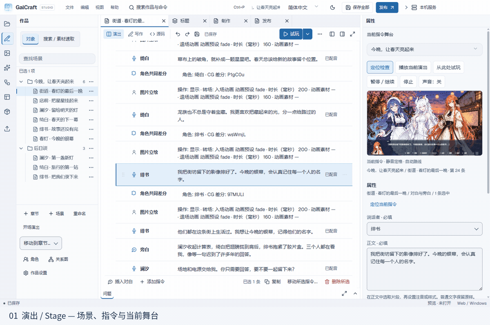
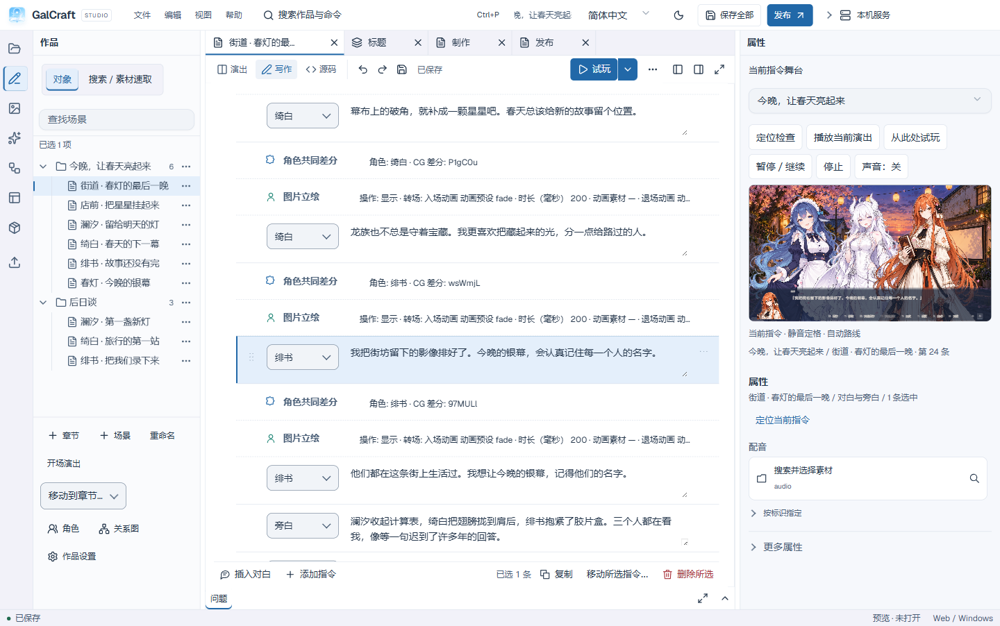
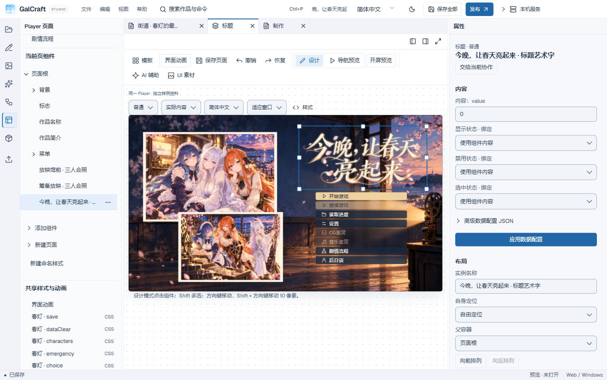
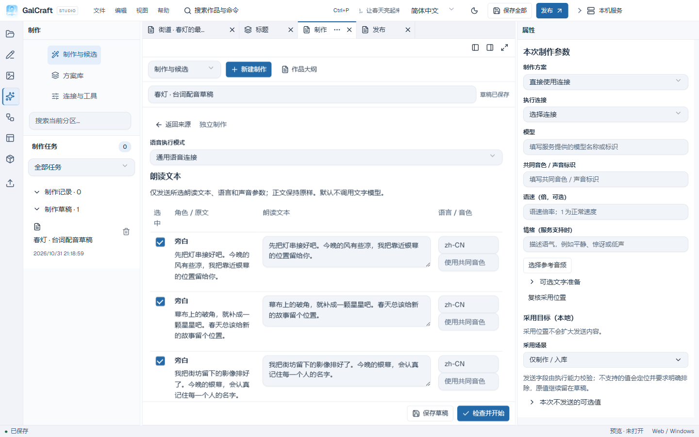
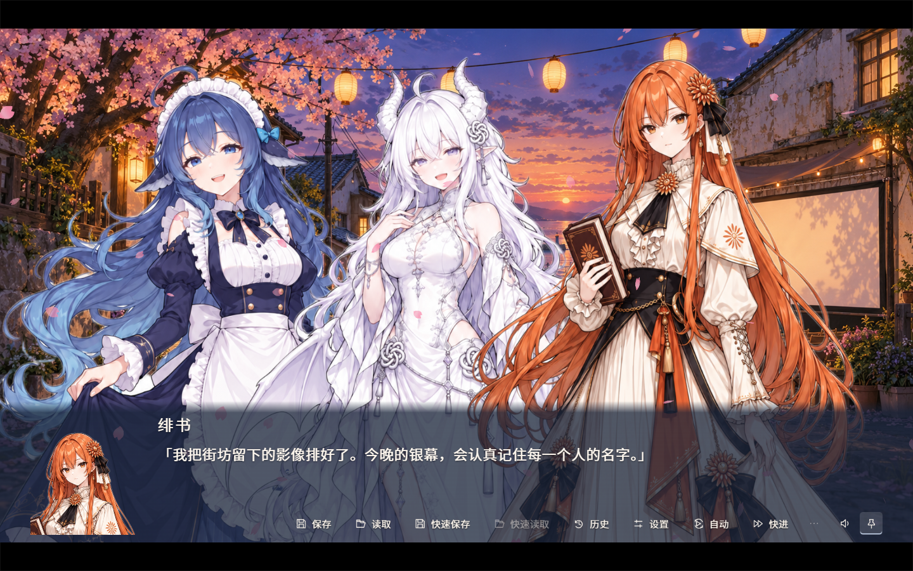

<div align="center">
  
  

# GalCraft

**An open-source visual novel authoring tool with visual editing.**

Studio · Early preview · Windows x64


[Get Studio](#start-creating) · [Play the sample](https://galcraft.dev/en/examples/) · [Tutorial sample](https://galcraft.dev/docs/en/sample-tutorial/) · [Product manual](https://galcraft.dev/docs/en/studio-guide/) · [简体中文](README.md)
</div>



Static views: [Staging](docs/media/stage.png) · [Writing](docs/media/writing.png) · [Pages](docs/media/pages.png) · [Voice production](docs/media/voice.png) · [Publishing](docs/media/publishing.png) · [Player](docs/media/player.png).

## What you can make

GalCraft combines an authoring workbench, production tools and a standalone Player. Your story, stage, pages and assets share one project; you review changes, save them and build a release.

- Write dialogue and branches through writing, staging and source views of the same scene.
- Arrange characters, backgrounds, cameras, transitions and reusable animations on the stage.
- Customize pages, menus, reading layouts and the Player's presentation.
- Import and organize assets with stable identities and explicit versions.
- Compare production candidates and adopt selected results into normal project edits.
- Produce character voices with per-line text, language, voice settings and audio review.
- Collaborate with an external MCP assistant on the same project and editing transactions.
- Playtest scenes and build standalone releases.

## Start creating

Download the recommended Windows x64 installer from the [0.1.0 release](https://github.com/TianyuEric/GalCraft/releases/tag/v0.1.0). Node users can run `npx --yes --package=@galcraft/studio@0.1.0 galcraft-studio` to open the browser workbench. The [Examples page](https://galcraft.dev/en/examples/) provides the playable story and tutorial downloads.

The npm entry installs the full application from this release into a user version cache on its first command. Preparation needs GitHub and npm access and downloads about 326 MiB plus runtime dependencies; later starts reuse the installation. The [release guide](docs/releasing.md) identifies separate source tags for the small entry and full application.

Once you have the tutorial `.galproject` backup, restore it as an independent copy in Studio, check its exact dependencies, change one line, save and play from that line. Follow [Your first project](https://galcraft.dev/docs/en/first-project/) for the maintained walkthrough. You can also create a new project from the Standard template.

Source archives contain development inputs. The Studio installer runs the editor, the separately prepared npm application provides a local service and browser UI, and a tutorial backup restores an editable project. Their release entries describe each artifact separately.

## Explore the workbench and the finished game

These images come from the real application and sample project. Open an image to inspect the full view.

<table>
  <tr>
    <td width="50%"><a href="docs/media/writing.png"></a><br><strong>Write a scene.</strong> Keep dialogue, speakers and scene navigation together. <a href="https://galcraft.dev/docs/en/basic-operations/">Basic operations</a></td>
    <td width="50%"><a href="docs/media/pages.png"></a><br><strong>Shape the reading experience.</strong> Edit pages and components against the work's Player canvas. <a href="https://galcraft.dev/docs/en/studio-guide/">Studio guide</a></td>
  </tr>
  <tr>
    <td><a href="docs/media/voice.png"></a><br><strong>Make character voices.</strong> Prepare text, languages and voice inputs, then review real task results. <a href="https://galcraft.dev/docs/en/sample-tutorial/">Sample tutorial</a></td>
    <td><a href="docs/media/player.png"></a><br><strong>Share a playable work.</strong> Keep the same story and presentation in the standalone Player. <a href="https://galcraft.dev/en/examples/">Play Light up spring tonight</a></td>
  </tr>
</table>

## Let AI assist your work

**Connect generation services.** Studio's built-in production core prepares inputs, freezes configuration, runs tasks and stores candidates. Configure your own service, model and credentials; services such as ComfyUI and VoiceStudio run in their own environment. Review text, images or audio before adoption. Applying a candidate changes the working project; saving writes the result to disk. Provider availability, usage and charges belong to the selected service.

**Connect an MCP assistant.** Bring a compatible external client and model, enable Studio's local MCP service, and bind a collaboration to a project and scope. The assistant reads, edits, previews and uses production through the same domain interfaces as Studio. You can inspect calls, pause further actions and query accepted work after a disconnect. See the [collaboration contract](docs/reference/collaboration.md) and [product manual](https://galcraft.dev/docs/en/studio-guide/).

## Playtest and publish

Playtest a scene or a selected line, then check the saved project and build a release. Web releases contain a standalone browser Player; Windows releases contain a standalone Windows Player. The Player carries adopted content and its exact runtime dependencies.

Android builders export a project, APK or AAB and require the corresponding JDK/Android SDK and signing choices. Current local checks cover debug-signed Android builds and Xcode project export on Windows. Android device runs, iOS archiving, Apple signing and iOS device runs need their respective environments. See [current platform scope](docs/reference/runtime-and-publishing.md). Studio's launch platform remains Windows x64.

## Plugins and external tools

Official and third-party plugins use the public SDK, exact package resolution and the same lifecycle. Extensions contribute commands, asset types, production operations, tools, pages or target builders through declared ports. External runtimes and native tools load through their owning host interfaces. Start with [plugin development](https://galcraft.dev/docs/en/plugin-development/) and the [engineering contract](docs/reference/plugins.md).

## Run from source

Use **Node.js 24.21.0** and **pnpm 12.3.4** on Windows x64. From the repository root:

```powershell
pnpm install --frozen-lockfile
pnpm --filter @galcraft/studio desktop
```

The desktop command builds the applications and default engine, prepares missing fonts and media tools, and opens the complete Electron host. First preparation needs network access. `pnpm dev` starts only the renderer's development server. See [development](docs/development.md) for tool preparation and debugging.

`apps/` assembles Studio and Players; `packages/` owns domain behavior and shared contracts; `plugins/` contains official extensions; `tools/` prepares media and distribution inputs. The npm application and plugin CLI support Node.js **22.12.0 or newer**; source development uses the fixed versions above.

## Documentation and contributions

The [online manual](https://galcraft.dev/docs/en/studio-guide/) is the single maintained product guide. Repository engineering documents use Chinese as their normative version; entry guides are bilingual.

[Getting started](docs/getting-started.md) · [Development](docs/development.md) · [Architecture](docs/architecture.md) · [Behavior reference](docs/reference/README.md) · [UI rules](docs/ui/README.md) · [Testing](docs/testing.md) · [Releasing](docs/releasing.md) · [Contributing](CONTRIBUTING.md) · [Security](SECURITY.md)

## Current scope

0.1.0 is an early preview. Studio provides authoring, production, collaboration and release workflows. AI-driven afterstory remains backlog. Generation services, external models, mobile toolchains and platform accounts need their own setup. The maintainer distributes through GitHub Releases and npm and uses PR checks to maintain the public development line.

## License and acknowledgements

Read [LICENSE](LICENSE), [licensing scope](LICENSING.md) and [third-party notices](THIRD_PARTY_NOTICES.md) for code, non-code assets and component exceptions. Bundled fonts, textures, tools and runtimes retain their own licenses and source notices. Authors manage the rights and distribution terms of their own works and imported assets.
