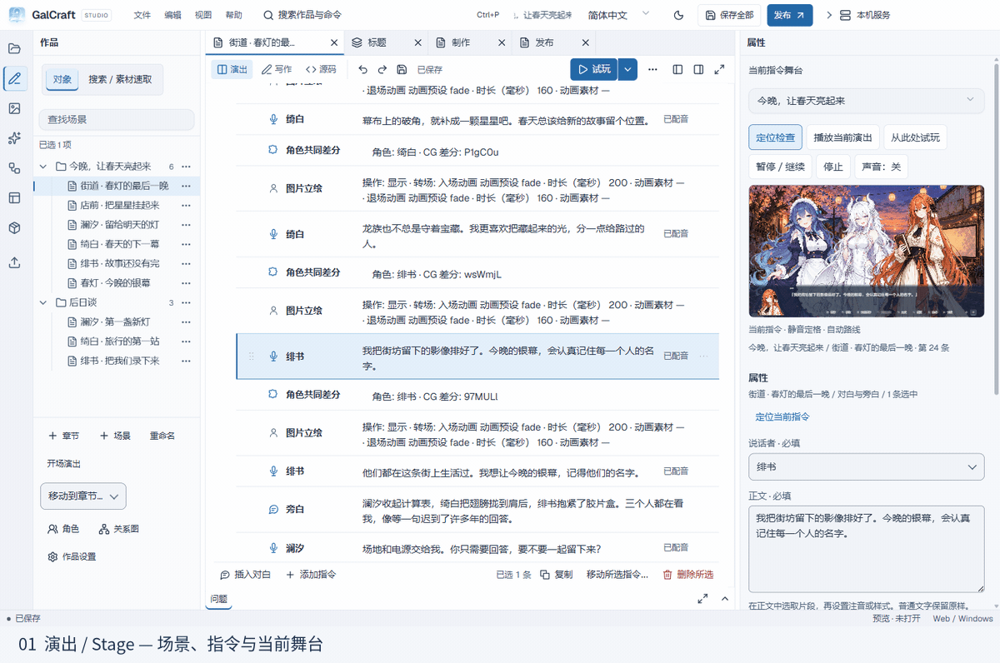
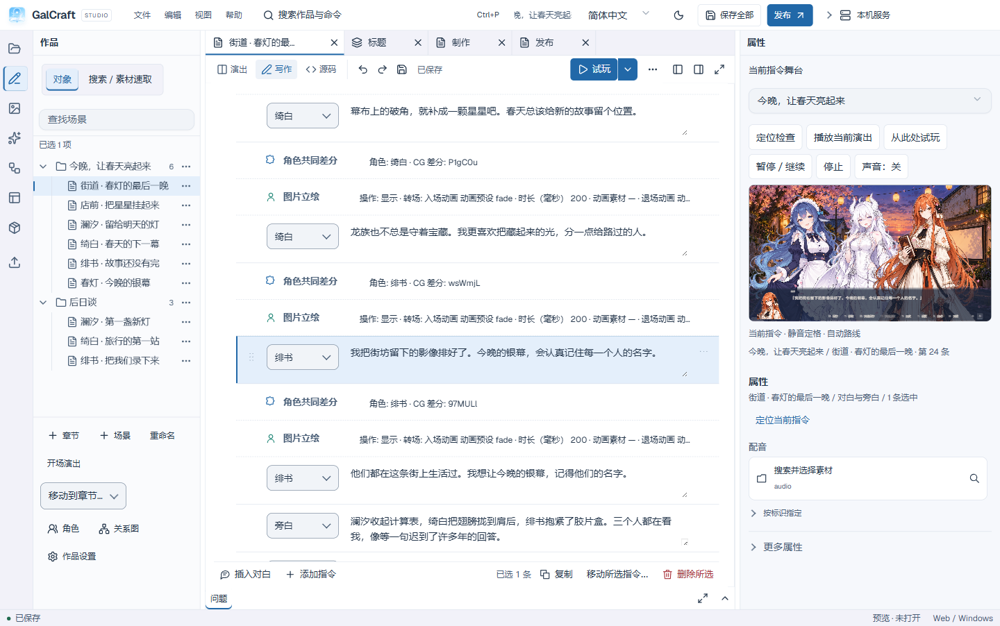
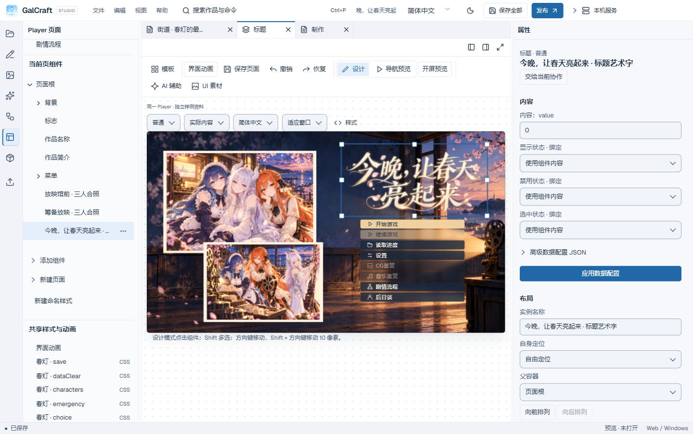
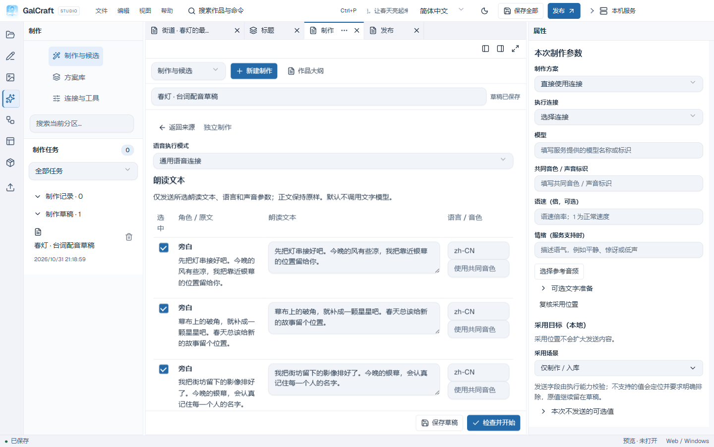

<div align="center">
  
  

# GalCraft

**开源、可视化的视觉小说与 Galgame 创作工具。**

Studio · 早期预览 · Windows x64


[获取 Studio](#开始创作) · [试玩样例](https://galcraft.dev/examples/) · [教学样例](https://galcraft.dev/docs/zh-CN/sample-tutorial/) · [产品手册](https://galcraft.dev/docs/zh-CN/studio-guide/) · [English](README.en.md)
</div>



静态大图：[演出](docs/media/stage.png) · [写作](docs/media/writing.png) · [页面](docs/media/pages.png) · [配音制作](docs/media/voice.png) · [发行](docs/media/publishing.png) · [Player](docs/media/player.png)。

## 用 GalCraft 完成什么

GalCraft 将创作工作台、制作工具和独立 Player 组织在同一作品中。创作者围绕剧情、舞台、页面与素材工作，审阅修改、保存内容，再构建发行物。

- 编写剧情与分支，在写作、演出和源码视图中编辑同一场景。
- 编排人物、背景、镜头、转场与可复用动画。
- 定制页面、菜单、阅读布局和 Player 的呈现。
- 导入并管理素材，保留稳定身份与明确版本。
- 比较制作候选，将选定成果采用为普通作品编辑。
- 制作角色配音，逐句管理正文、语言、音色输入与试听。
- 与外部 MCP 助手协作，操作同一作品与编辑事务。
- 从场景或当前语句试玩，构建独立发行物。

## 开始创作

创作者从[0.1.0 Release](https://github.com/TianyuEric/GalCraft/releases/tag/v0.1.0)下载 Windows x64 安装器；这是推荐入口。Node 用户执行 `npx --yes --package=@galcraft/studio@0.1.0 galcraft-studio` 启动浏览器工作台。[示例页面](https://galcraft.dev/examples/)提供《今晚，让春天亮起来》试玩与教学包下载。

npm 入口首次执行时从本次 Release 自动安装完整应用到用户版本缓存，需要访问 GitHub 与 npm，下载约 326 MiB 及运行依赖；后续启动复用安装。[发行说明](docs/releasing.md)分别标明轻量入口与完整应用的源码标签。

取得教学 `.galproject` 备份后，在 Studio 中恢复为独立副本，检查精确依赖，修改一句对白，保存并从此句试玩。持续维护的步骤见[第一个作品](https://galcraft.dev/docs/zh-CN/first-project/)。作者也可以从“标准”模板新建练习作品。

源码归档包含开发输入；Studio 安装器运行编辑器；独立准备的 npm 应用提供本机服务与浏览器界面；教学备份用于恢复可编辑作品。各产物在相应发行入口分别说明用途。

## 看看工作台与作品

以下画面取自真实应用与样例作品。点击图片查看完整界面。

<table>
  <tr>
    <td width="50%"><a href="docs/media/writing.png"></a><br><strong>连续写作。</strong>作者在场景树、对白与说话者之间保持上下文。<a href="https://galcraft.dev/docs/zh-CN/basic-operations/">基本操作</a></td>
    <td width="50%"><a href="docs/media/pages.png"></a><br><strong>安排阅读体验。</strong>作者对照作品画布编辑页面、组件与属性。<a href="https://galcraft.dev/docs/zh-CN/studio-guide/">Studio 指南</a></td>
  </tr>
  <tr>
    <td><a href="docs/media/voice.png"></a><br><strong>制作角色配音。</strong>作者准备文本、语言与声音输入，再审阅实际任务结果。<a href="https://galcraft.dev/docs/zh-CN/sample-tutorial/">样例教程</a></td>
    <td><a href="docs/media/player.png"></a><br><strong>交付可玩的作品。</strong>独立 Player 使用同一剧情和作品呈现。<a href="https://galcraft.dev/examples/">试玩《今晚，让春天亮起来》</a></td>
  </tr>
</table>

## 让 AI 协助创作

**连接生成服务制作候选。** Studio 内置制作核心负责输入准备、配置冻结、调度、任务与候选。作者准备自己的服务、模型与凭据；ComfyUI、VoiceStudio 等服务在各自环境运行。作者比较文本、图像或声音，再采用成果。“应用”改变作品工作内容，“保存”写入磁盘。服务可用性、用量与费用沿所选提供方的实际能力和回执显示。

**通过 MCP 编辑同一作品。** 作者准备兼容的外部客户端与模型，启用 Studio 本机 MCP 服务，将协作绑定到作品与执行范围。助手通过与 Studio 相同的领域接口读取、编辑、预览和制作。作者可以检查调用、暂停后续动作，并在断连后查询已受理业务。工程规则见[协作契约](docs/reference/collaboration.md)，操作入口见[产品手册](https://galcraft.dev/docs/zh-CN/studio-guide/)。

## 试玩与发行

作者从场景或选定语句试玩，检查已保存作品后构建发行物。Web 发行物包含独立浏览器 Player，Windows 发行物包含独立 Windows Player。Player 随包携带已采用内容及精确运行依赖。

Android 构建器提供工程、APK、AAB，实际构建需要相应 JDK、Android SDK 与签名配置。当前本地检查覆盖调试签名的 Android 构建和 Windows 上的 Xcode 工程导出；Android 设备运行、iOS 归档、Apple 签名及真机运行由相应环境检查。详细范围见[运行与发行边界](docs/reference/runtime-and-publishing.md)。Studio 首发运行平台为 Windows x64。

## 插件与外部工具

官方与第三方插件共用公开 SDK、精确包定位及生命周期。插件通过声明端口贡献指令、素材类型、制作操作、工具、页面或目标构建器；外置运行时和原生工具经所属宿主接口装载。作者从[插件开发教程](https://galcraft.dev/docs/zh-CN/plugin-development/)及[插件工程契约](docs/reference/plugins.md)开始。

## 从源码运行

开发者在 Windows x64 准备 **Node.js 24.21.0** 与 **pnpm 12.3.4**，在仓库根执行：

```powershell
pnpm install --frozen-lockfile
pnpm --filter @galcraft/studio desktop
```

完整桌面命令构建应用与默认引擎、准备缺失字体和媒体工具，再打开 Electron 宿主。首次准备需要网络。`pnpm dev` 启动 renderer 开发服务。工具准备与调试见[开发说明](docs/development.md)。

`apps/` 组装 Studio 与 Player；`packages/` 持有领域行为和共享契约；`plugins/` 提供官方扩展；`tools/` 准备媒体与发行输入。npm 应用及插件 CLI 最低支持 **Node.js 22.12.0**；源码开发使用上述固定版本。

## 文档与参与贡献

[在线手册](https://galcraft.dev/docs/zh-CN/studio-guide/)是产品帮助的唯一维护正文。仓库工程规范以中文为主版，入口指南提供中英。

[上手入口](docs/getting-started.zh-CN.md) · [开发](docs/development.md) · [架构](docs/architecture.md) · [行为参考](docs/reference/README.md) · [UI 规则](docs/ui/README.md) · [测试](docs/testing.md) · [发行](docs/releasing.md) · [贡献](CONTRIBUTING.zh-CN.md) · [安全](SECURITY.md)

## 当前阶段与支持范围

0.1.0 定位为早期预览。Studio 提供创作、制作、外部协作与发行路径。AI 后日谈能力放在 Backlog。生成服务、外部模型、移动工具链和平台账号由使用者分别准备。维护者通过 GitHub Release 和 npm 分发，通过 PR 的 CI 检查维护公开主线。

## 许可与致谢

[LICENSE](LICENSE)、[许可范围](LICENSING.md)与[第三方声明](THIRD_PARTY_NOTICES.md)说明代码、非代码素材和组件例外。字体、纹理、工具与运行时保留自身许可及来源。作品作者管理自己作品和导入素材的权利与分发条件。
