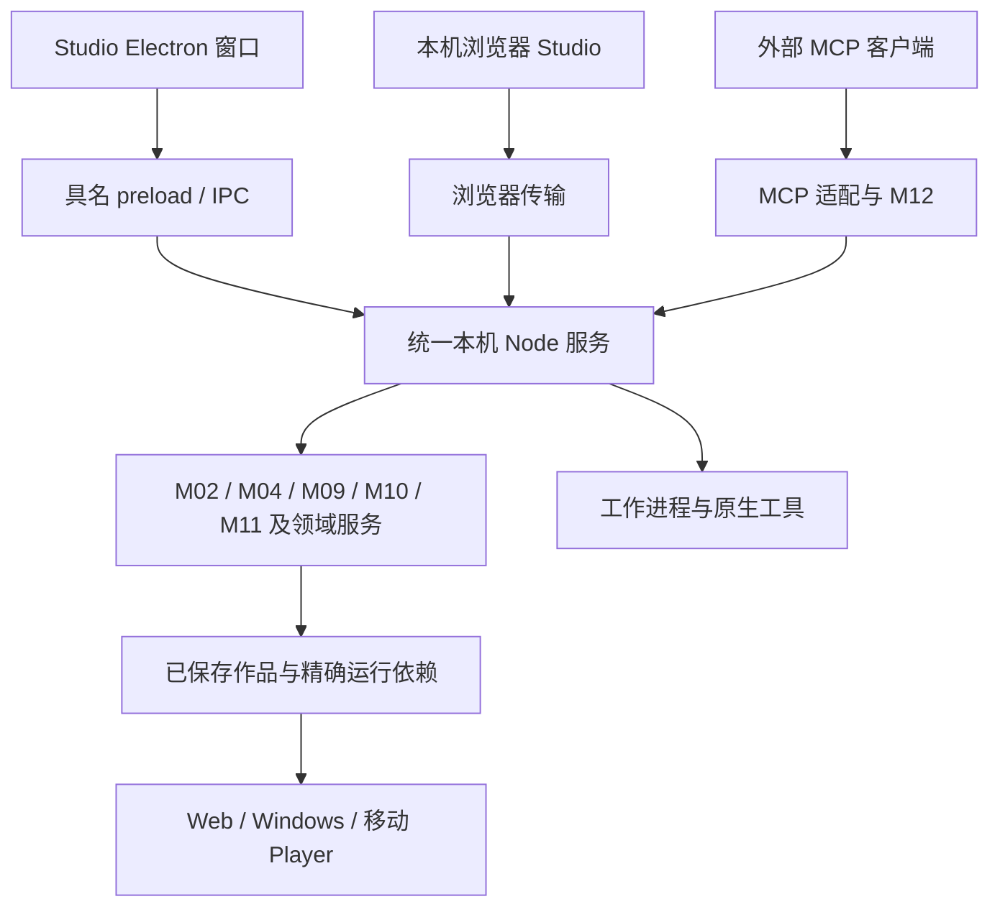
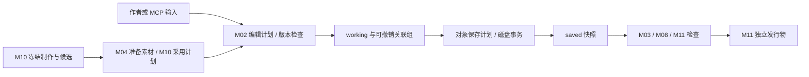

# 架构与状态责任

GalCraft 将创作、制作与运行分成有明确状态拥有者的模块。Studio 组装编辑能力，Player 消费已检查的作品快照及精确运行依赖。共享契约和实现放在 `packages/`，应用通过包出口组装。

## 模块与目录

| 模块 | 实现位置 | 责任与状态 |
|---|---|---|
| M01 工作台 | `apps/studio/renderer/` | 交互、工作文档、选区、输入缓冲及个人布局/返回位置偏好 |
| M02 作品与文档 | `packages/documents/` | 作品 working/saved、关联组、编辑事务、撤销、保存、备份与恢复 |
| M03 语言 | `packages/dsl/` | DSL、指令目录、解析、编译、引用与诊断 |
| M04 素材 | `packages/assets/` | 资源身份、不可变版本、类型目录、导入/加工与租约；通过 M02 提交作品索引 |
| M05 运行 | `packages/runtime/` | 剧情执行、等待、变量、分支及执行快照 |
| M06 舞台 | `packages/stage/` | 画面、声音、动画、对象实例与演出时钟 |
| M07 Player | `packages/player-ui/` | 阅读交互、存档、继续点、历史及玩家个人资料 |
| M08 模板 | `packages/templates/` | 页面、组件、样式、菜单能力与组合校验 |
| M09 插件 | `packages/plugins/` | 精确包安装、依赖计划、贡献目录与租约生命周期 |
| M10 制作 | `packages/authoring/` | 方案、草稿、规划、冻结、调度、个人任务/候选与采用计划 |
| M11 发行 | `packages/publishing/` | 引擎目录、目标检查、发行计划、构建及发行物 |
| M12 协作 | `packages/collaboration/` | 个人协作会话、作品绑定、执行范围、调用记录与结果引用 |
| 共享结构 | `packages/contracts/` | 实际跨模块使用的类型、schema 和版本契约 |
| 服务协议 | `packages/generation-services/` | 生成服务的公开协议和适配基础 |

`apps/studio/` 提供 Node 服务/CLI、Electron main/preload 适配和共享 renderer；`apps/player-web/`、`apps/player-windows/` 组装运行端。`plugins/` 承载官方能力，`tools/media/`、`tools/matting/` 等目录承载独立工具和准备脚本。

其他模块通过所属接口提交结果。M04 准备素材，再由 M02 提交索引；M10 准备候选采用，再由 M02 应用作品修改；M12 转发有范围的实际调用，并引用提供方结果。各模块保留同一对象的真实身份、版本及生命周期。

## 应用、进程与依赖

本机服务唯一持有目录/文件句柄、凭据和长任务。桌面窗口与浏览器页面消费同一领域服务；各入口维护自己的工作台偏好。关闭客户端解除订阅，服务和任务按所属生命周期继续。明确停止服务时，宿主先持久化恢复数据和调用事实，再释放资源。重启后各提供方恢复原业务身份。

`packages/` 通过公开包出口协作；应用导入共享包，包保持独立于应用。Studio 与 Player 共用能力和样式时使用所属包出口。renderer 运行导入必须可在浏览器装载；Node、Electron、原生模块及凭据操作位于所属宿主。M10 的 `production` 总出口含 Node 实现，renderer 仅从中导入类型，运行操作目录使用 `production/operations`。

外置运行时由清单声明能力键，所属宿主按精确包版本装载真实入口。插件分环境交付定义、服务、编辑或运行产物，完整打包实际依赖图。M09 对官方与第三方插件执行同一公开契约。

## 编辑、制作与发行的数据流

M02 的工作版本、保存版本和恢复草稿各有用途。应用编辑、采用、撤销和丢弃改变工作内容；保存按对象和必要关联写入磁盘；备份和正式构建读取 saved。更晚编辑及未选对象继续 dirty。M10 个人任务与候选保留完整冻结事实，作品只保存已采用内容及必要来源摘要，Player 携带实际运行所需部分。

M05/M06 执行剧情与演出。M07 区分正式玩家资料、Studio 试玩和候选预览域；预览与候选操作使用所属隔离域。M08 提供作品页面和阅读样式，Studio 主题保持自己的作用域。

## 接口责任与修改方法

提供方定义 schema、版本、状态与失败责任，消费者显示实际回执和可执行恢复。共享契约只包含真实使用结构，字段与版本的完整定义由源码和 schema 维护。

修改包出口、IPC、宿主接线或清单能力时，负责人同步实际处理方、preload、桌面/浏览器传输和消费者，并选择能发现该变化错误的类型、边界、构建或启动组装检查。根 `pnpm typecheck` 包含架构依赖检查。

具体行为见[保存与撤销](reference/editing-and-saving.md)、[制作与恢复](reference/production-and-recovery.md)、[插件](reference/plugins.md)、[宿主与 IPC](reference/host-and-ipc.md)、[协作](reference/collaboration.md)、[运行与发行](reference/runtime-and-publishing.md)及 [UI 规则](ui/README.md)。
