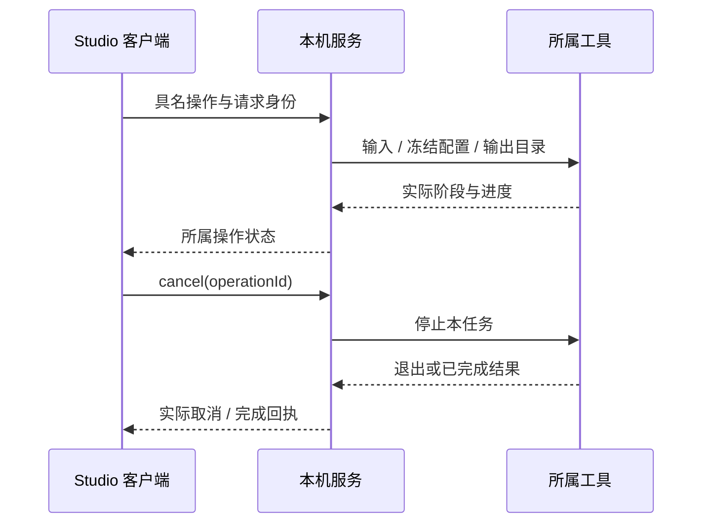

# 宿主、进程与 IPC

Studio 的 Electron 与本机浏览器入口复用同一 Node 领域服务。宿主持有作品会话、文件、个人凭据、资源访问和长任务，renderer 持有 M01 交互。本机 MCP 入口将调用交给 M12 和实际业务提供方。

## 传输与生命周期

桌面使用具名 `StudioBridge`、preload 和 IPC，浏览器通过对应传输消费同一桥接契约。Windows Player 使用 `PlayerIpc` 约束处理表。参数与结果按所属运行时 schema 校验；状态由领域提供方产生，传输层保留身份与失败含义。

新增接口同步唯一契约、实际处理表、注册/传输层、preload 和消费者。应用类型检查覆盖真实边界；必需提供方通过实际服务启动组装检查。renderer 调用具体业务能力，路径解析与命令执行留在所属宿主。

Electron 窗口启用 `contextIsolation: true`、`nodeIntegration: false`、`sandbox: true`。打包界面从固定应用入口加载，外部手册使用系统浏览器。本机服务沿回环监听并检查 Host/Origin，MCP 传输连接与作品协作身份分别管理。

关闭窗口、标签或面板解除客户端订阅，服务和已受理任务继续按业务生命周期运行。明确停止服务时，宿主持久化恢复输入、任务身份和调用事实，再释放资源。异常重启后，M02 恢复事务与草稿，M04/M10 及其他提供方核实原业务。

## 资源与个人数据

M04 通过稳定 `assetId` 和明确版本返回资源租约，消费者持有期间使用其 URI，并在切换、关闭或过期返回时释放。桌面资源协议按已注册作品或运行包解析：

```text
galcraft-resource://project-<小写projectId>/<assetId>/<variantId>/<relative>
```

协议主机名使用作品 ID 的小写命名空间，路径中素材与版本 ID 保留大小写。宿主提供真实 MIME 和视频 Range；Web 发行使用清单相对 URL。renderer 通过资源能力读取内容，本地文件位置与凭据目录由宿主管理。

连接配置保存凭据引用，密钥写入个人宿主存储。桌面和浏览器服务共用实际凭据来源；读取失败使连接保持未就绪并提供恢复入口。作品、任务导出和发行物保留所属可公开来源信息。

M01 工作台布局、返回位置和未应用输入属于个人状态，宿主将其写入个人目录；这些偏好保持独立于 M02 作品事务。桌面和浏览器分别保存自己的工作台表现。

## 工具与工作进程

编译、大文本、转码和推理使用适用的工作进程或外部工具。任务携带 operation 身份、输入文件、配置和自身输出目录，使用参数数组及 `shell: false` 启动工具，Windows 后台执行隐藏窗口。stdout 返回结构化进度与结果，诊断移除认证信息。

工具完成前，产物保留在所属临时目录。取消先执行该工具的停止协议，超时后结束本任务进程；已完成结果保留为未采用内容。作者独立启动的 ComfyUI 等服务由作者管理。工作进程退出产生实际失败回执并保留旧有效结果。



Windows Player 的关闭先交给 M07：剧情中保存可继续位置，成功后确认关闭；失败或取消恢复来源。标题页保留已有继续点。页面与预览卸载释放自身监听、媒体和资源租约。

开发命令见[开发](../development.md)，任务恢复见[制作](production-and-recovery.md)，受理调用查询见[协作](collaboration.md)。
