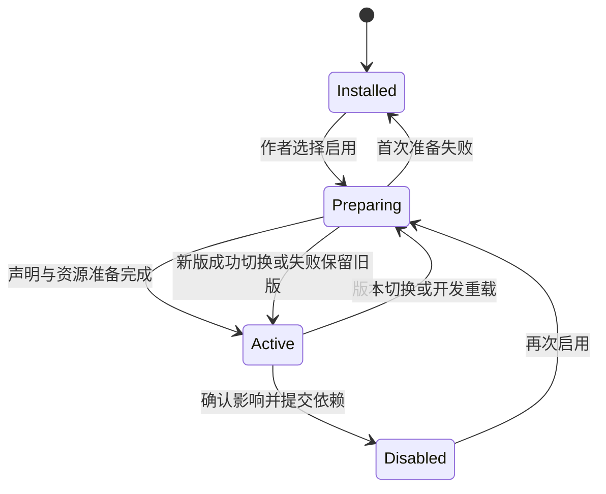

# 插件与精确依赖

M09 管理本机精确包、作品依赖计划、公开贡献和装载租约。贡献所属模块解释业务；官方与外部插件使用同一 schema、SDK、入口和生命周期。完整字段由 `packages/plugins/`、`packages/contracts/` 及实际插件清单维护。

## 当前能力与官方插件索引（0.1.0）

Studio 内置作品编辑、MCP 协作、制作任务与候选采用、素材管理及 Web／Windows 发行管理。作者使用[中文插件手册](https://galcraft.dev/docs/zh-CN/plugins/)或[English plugin manual](https://galcraft.dev/docs/en/plugins/)查阅具体用途、使用入口和准备条件；本索引提供稳定 ID 与源码位置。

维护者通过[随附目录](../../plugins/catalog.json)选择13个官方插件。目录中的 `studioService: true` 标记以下6个 Studio 默认装配包；宿主按需装载这些包，作者配置实际服务连接或选择发行目标。

### Studio 默认装配

| 名称 | 插件 ID | 作用 | 源码目录 |
|---|---|---|---|
| 常用生成服务 | `org.galcraft.generation-services` | 作者连接文字、图像、语音和音乐服务，执行制作任务并收集候选。 | [official-generation-services](../../plugins/official-generation-services/) |
| ComfyUI 执行能力 | `org.galcraft.comfyui` | 作者执行 ComfyUI API 工作流，配置输入／输出映射并取回候选。 | [official-comfyui](../../plugins/official-comfyui/) |
| NovelAI 创作能力 | `org.galcraft.novelai` | 作者编辑结构化提示与参考参数，生成图像候选，并可通过文字连接辅助编写提示词。 | [official-novelai](../../plugins/official-novelai/) |
| VoiceStudio | `org.galcraft.voicestudio` | 作者发现实际引擎与声音，制作配音、设计样音、参考克隆和录音逐字稿。 | [official-voicestudio](../../plugins/official-voicestudio/) |
| Android 发行目标 | `org.galcraft.android` | 作者导出 Android 工程，或调用 JDK／Android SDK／Gradle 构建 APK／AAB。 | [official-android](../../plugins/official-android/) |
| iOS 发行目标 | `org.galcraft.ios` | 作者导出 Xcode 工程，并在 macOS 工具链下生成 Xcode 归档。 | [official-ios](../../plugins/official-ios/) |

### 在作品中启用

Studio 同时提供以下7个普通作品插件。作者或作品模板选择所需精确版本，M09 将其记录在作品依赖中。

| 名称 | 插件 ID | 作用 | 源码目录 |
|---|---|---|---|
| Motion Canvas 视频 | `org.galcraft.motion-canvas` | 作者编辑 TS／TSX 动画源，使用作品素材在本机渲染标准 MP4，并保留可继续编辑的源。 | [motion-canvas](../../plugins/motion-canvas/) |
| GCA 动画制作 | `org.galcraft.animation-generation` | 作者使用兼容文字连接新建、局部修改或重写 GCA 动画，审阅后采用候选。 | [animation-generation](../../plugins/animation-generation/) |
| 可编辑编曲 | `org.galcraft.music-composition` | 作者编辑多轨乐谱、试听采样音色并渲染音乐，也可通过文字连接辅助作曲。 | [music-composition](../../plugins/music-composition/) |
| Breeze／Irodori 配音 | `org.galcraft.voice-comfy` | 作者通过 ComfyUI 制作 Breeze 中英配音和 Irodori 日语配音，按模式使用声音设计、参考克隆或表演描述。 | [official-voice-comfy](../../plugins/official-voice-comfy/) |
| Live2D | `org.galcraft.live2d` | 作者导入 Cubism 模型，配置动作和表情，并在舞台演出中使用模型。 | [official-live2d](../../plugins/official-live2d/) |
| Steam | `org.galcraft.steam` | 作者从剧情触发 Windows x64 Steam 成就解锁；Studio 试玩使用模拟结果。 | [official-steam](../../plugins/official-steam/) |
| AI 后日谈 · 作者配置 | `org.galcraft.ai-epilogue` | 作者配置路线角色、结局、许可范围与素材白名单，并预览发送上下文；当前交付范围为作者配置与上下文预览。 | [ai-epilogue](../../plugins/ai-epilogue/) |

### 源码提供的可选插件示例

| 名称 | 插件 ID | 作用 | 源码目录 |
|---|---|---|---|
| 好感度（可选 SDK 示例） | `org.galcraft.affection` | 作者配置关系数值，使用增减、设值、比较条件和关系页展示；作者按源码 README 单独构建、安装并在作品启用。 | [official-affection](../../plugins/official-affection/) |

好感度采用单独构建和安装方式；上面的两组定义 Studio 的13项随附清单。[插件开发示例](../../plugins/development-examples/)提供 SDK 用法，开发者按[插件开发教程](https://galcraft.dev/docs/zh-CN/plugin-development/)创建自己的包。

## 包、身份与入口

插件包声明稳定 ID、精确版本、引擎范围、SDK 主版本、目标、依赖、入口、文件及贡献键。`.galplugin` 是可安装 ZIP，JS 入口为 ESM。定义入口提供无 DOM 的 schema 和声明；服务、编辑、运行及原生入口按实际环境装载。插件交付完整依赖图，React/Pixi 从公开 SDK 的同实例入口获得。

依赖范围用于选择兼容候选，作品 Lock 写入精确身份与版本。同一作品的一个插件 ID 启用一个版本。缺少精确版本时，宿主保留原内容、引用及状态并报告缺项，作者补齐实际包或明确调整依赖。引擎遵循同样的精确选择规则。

当前自有发布组件版本为 `0.1.0`，SDK 主版本为 `0`；`sdkMajor` 按实际主版本匹配并允许非负整数。`schemaVersion`、贡献 `contractVersion` 及文档/进度/长期状态版本分别定义各自数据边界。

运行依赖随插件打包，声明的原生文件按目标和架构交付。宿主从清单能力键及公开入口取得业务实现，默认装配目录只保存包身份和模板引用。定义、服务和运行图保持闭合；Player 只收集实际运行入口、资源与依赖。

## 安装、启用与切换

安装先解包到本机临时目录，检查清单、文件、入口和目标，成功后提交本机安装目录。**安装改变本机可用包；作品启用、Lock 修改和活动贡献切换各自通过所属计划执行。** 失败保留上次有效包。

启用或切换先生成影响计划，列出当前/目标版本、引用位置、数据及可用转换。M09 按拓扑顺序准备依赖和独立注册表；循环依赖报告实际环路径。贡献键冲突、schema 缺失或入口不可用时，准备失败并保留有效活动表。

切换成功后，旧注册表解除订阅并释放所属资源。停用保留作品文档和插件状态，缺少必需贡献时阻断受影响执行与发行。跨版本升级在副本执行各域转换并验证旧档，作者确认后经 M02 提交；转换能力不足时显示具体兼容限制。原作品可继续使用受支持的精确旧包。

当前开发安装允许刷新同 ID、同 `0.1.0` 的产物。M09 在可替换安装目录之外持有实际模块图；活动定义、服务、运行和开发租约继续执行原图，后续装载取得新修订。最后一个租约释放后清理所属副本。安装刷新保留旧任务的冻结事实。正式对外发布后，同名同版本保持相同内容，修复发布新版本。

## 贡献与状态责任

| 贡献 | 提供方责任 | 消费者责任 |
|---|---|---|
| 指令和条件 | 提供公开字段/schema，指令返回待提交变化，条件保持纯计算 | M03 提供同源编辑/检查；M05 按执行令牌提交 |
| 文档、工具和字段编辑器 | 提供 schema、引用收集/重写及编辑提案 | M02 管事务、历史和保存，M01 管交互 |
| 素材类型与加工 | 声明类型身份/版本、数据校验、引用处理、扩展名和目标能力 | M04 形成同一类型目录、不可变版本与资源租约 |
| 舞台与 Player 页面 | 按运行环境提供真实入口，释放实例和订阅 | M06 管演出时钟，M07 管页面来源和资料域 |
| 制作操作与生成提供方 | 声明操作、输入、模型能力、协议和实际执行入口 | M10 管任务、冻结、候选和采用 |
| Studio UI 与外部工具 | 按公开槽位/工具端口贡献，说明参数和结果 | M01 展示，M12 执行范围及调用关联 |
| 目标构建器 | 声明目标、架构、工具要求、选项 schema 与生产入口 | M09 提供精确租约，M11 冻结计划和提交发行物 |

Explorer、选择器、Inspector、候选和预览消费同一素材类型身份与版本。类型专属数据通过其 schema 及所属编辑事务处理；缺包时，宿主保留原数据并诊断受影响编辑、引用处理或构建。

Studio 默认服务与普通作品插件分别展示。默认服务使用宿主实际装配身份和配置说明；普通插件的启用、停用与版本切换作用于作品依赖。M10 制作核心随 Studio 内置；生成提供方扩展该核心的能力目录。

## 开发消费

开发者通过公开 SDK 创建、构建和打包插件，构建成功后让 Studio 装载开发目录。源码更新后显式构建、重载；重载失败继续使用有效贡献。运行中重载为新试玩建立新会话，旧会话保留到新会话准备成功。

打包工具按清单检查实际文件和目标入口，临时写包后提交。开发者再通过普通安装入口验证启用、编辑、保存及声明目标的运行。教程见[插件开发](https://galcraft.dev/docs/zh-CN/plugin-development/)，本地 SDK 分发与独立消费者命令见[发行](../releasing.md)。
